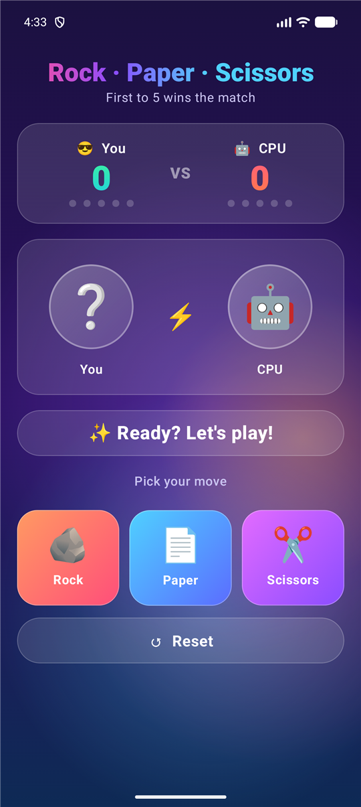
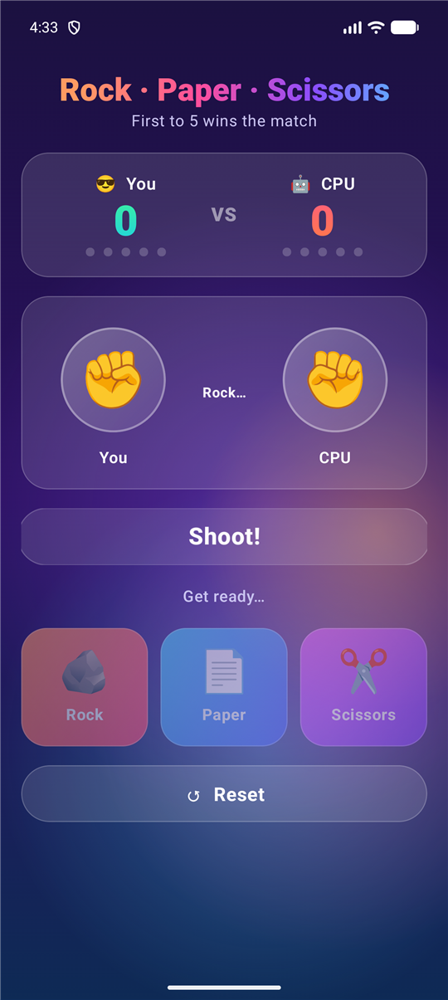
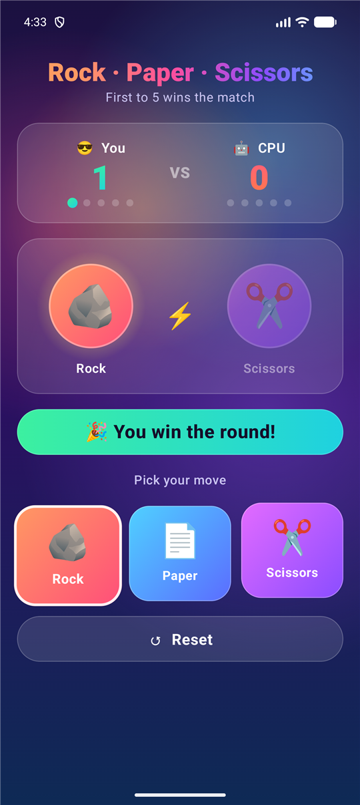
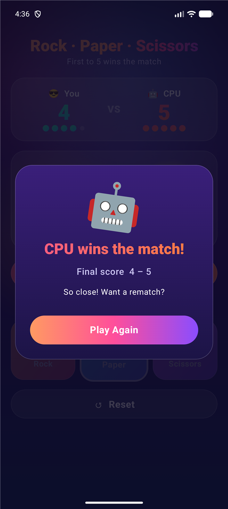

<div align="center">

<a href="https://androai.io/webinar/register">
  
</a>

### 🎓 Want to build Android apps like this one?

**Join the free live webinar by [AndroAI](https://androai.io) and learn how to build, design and publish your own Android apps, step by step.**

<a href="https://androai.io/webinar/register"><b>👉 Register for the Webinar Now: androai.io/webinar/register 👈</b></a>

[🌐 Website](https://androai.io) &nbsp;•&nbsp; [📚 Courses](https://androai.io/courses) &nbsp;•&nbsp; [🛒 Source Code Market](https://androai.io/market)

---

# ✊ ✋ ✌️ Rock · Paper · Scissors

**A beautiful, animated Rock Paper Scissors game for Android, built with Kotlin and Jetpack Compose.**


</div>

---

## 📸 Screenshots

<div align="center">

| Home | Rock… Paper… Shoot! | Round Result | Match Over |
|:---:|:---:|:---:|:---:|
|  |  |  |  |

</div>

---

## ✨ Features

- 🎨 **Animated gradient background** with a glassmorphism UI
- ✊ **"Rock… Paper… Shoot!" shake animation** before every reveal
- 🏆 **First to 5 wins**: live scoreboard with progress dots for You vs CPU
- 🔥 **Win streak** tracking
- 🎉 **Round result banner**: green for a win, red for a loss, yellow for a draw
- 🤖 **Match-over dialog** with final score and a one-tap **Play Again**
- 🔄 **Reset** at any time
- 📱 Edge-to-edge layout, works on phones of any size, and keeps the score on screen rotation
- ✅ Unit tests for the game rules

---

## 📥 How to Download This Source Code

### Option 1: Download ZIP (easiest, no Git needed)

1. Click the green **`<> Code`** button at the top of this page.
2. Click **Download ZIP**.
3. Extract (unzip) the downloaded file.

Or download directly: **[⬇️ rock_scissor_paper_game-main.zip](https://github.com/vvsdevs/rock_scissor_paper_game/archive/refs/heads/main.zip)**

### Option 2: Clone with Git

```bash
git clone https://github.com/vvsdevs/rock_scissor_paper_game.git
cd rock_scissor_paper_game
```

---

## ▶️ How to Run the App

1. Install the latest **[Android Studio](https://developer.android.com/studio)**.
2. Open Android Studio → **File → Open** → select the downloaded project folder.
3. Wait for **Gradle Sync** to finish (the first time can take a few minutes).
4. Connect an Android phone (with **USB debugging** turned on) or start an **emulator**.
5. Press the green **▶ Run** button.

Build an APK from the command line:

```bash
./gradlew assembleDebug
# APK: app/build/outputs/apk/debug/app-debug.apk
```

---

## 🎮 How to Play

1. Tap **Rock**, **Paper**, or **Scissors**.
2. Watch the countdown: *Rock… Paper… Shoot!*
3. The CPU picks its move at random.
   - 🪨 Rock beats ✂️ Scissors
   - ✂️ Scissors beats 📄 Paper
   - 📄 Paper beats 🪨 Rock
4. The first to **5 points** wins the match!

---

## 🛠️ Tech Stack

| | |
|---|---|
| **Language** | Kotlin |
| **UI** | Jetpack Compose + Material 3 |
| **Animations** | Compose Animation APIs + Canvas |
| **Min / Target SDK** | 24 / 37 |
| **Build** | Gradle Kotlin DSL + Version Catalog |

## 📂 Project Structure

```
app/src/main/java/com/game/rockscissors/
├── MainActivity.kt        # Game screen, animations, game logic
└── ui/theme/              # Colors, typography, theme
app/src/test/java/com/game/rockscissors/
└── GameRulesTest.kt       # Unit tests for win/lose/draw rules
```

---

<div align="center">

## 🚀 Learn to Build Apps Like This!

This project was built at an **[AndroAI](https://androai.io)** live session.
Want to build your **own Android apps and games** from scratch, even as a beginner?

<a href="https://androai.io/webinar/register">
  
</a>

⭐ **If you liked this project, please give it a star!** ⭐

Made with ❤️ by **[AndroAI](https://androai.io)**

</div>
